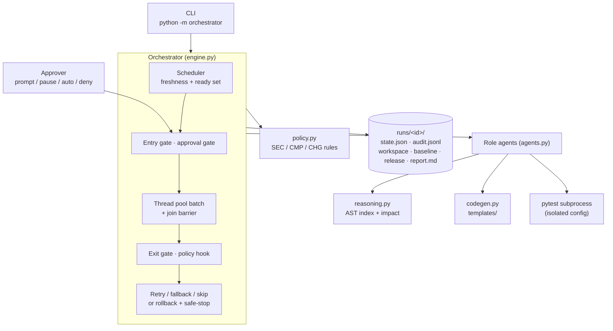
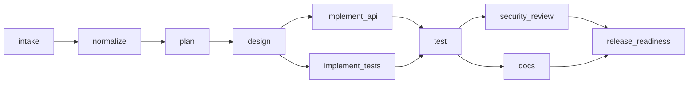

# Architecture

## Components

## Pipeline

Human gates are conditional and evaluated against upstream outputs:

| Gate (before stage) | Fires when | Why it is high-impact |
|---|---|---|
| `plan` | `normalize` found ambiguous terms | The interpretation decides everything downstream |
| `implement_api` | `design` proposes a migration on existing data | Schema change on live data |
| `release_readiness` | Always | Release is irreversible from the agent's side; agents never merge |

## Control flow

Each loop iteration:

1. **Safe-stop check.** STOP file, attempt budget, wall-clock budget per execution segment, and a re-plan oscillation cap.
2. **Apply requirement changes** whose trigger stage has passed (`requirement_version` is bumped).
3. **Freshness.** A stage is fresh if it finished OK (`passed`, `fallback` or `skipped`), all its deps are fresh, and its recorded `input_hash` equals the hash of its deps' current `output_hash`es (root stages also hash the requirement text).
4. **Ready set** = not fresh, with all deps fresh. A ready stage that has an OK record is being invalidated, and is logged as `replan-stale`.
5. **Approvals.** For each ready stage with a gate, look for an approval bound to its current `input_hash`. Otherwise ask the approver. If the approver returns `None`, the run pauses (`waiting_approval`) and persists, and `resume` continues it later.
6. **Batch.** All runnable stages execute concurrently and join at a barrier. Per stage:
   - entry gate (required upstream keys)
   - agent call
   - exit gate
   - policy hook
   - on failure: bounded retry with exponential backoff (policy and entry-gate failures are non-retryable), then the fallback agent, then a skip if the stage is optional, else failed.
7. **Merge after the barrier** in a deterministic order. If a re-run stage produced the same output hash, log `replan-converged`: its downstream stays fresh and is not re-run.
8. **Any failed stage → rollback.** The workspace is restored from `baseline/`, mutating stages are marked `rolled_back`, incidents are closed, and the run safe-stops.

## Key decisions

- **Hash-based freshness instead of hand-written re-plan rules.** Re-planning, partial re-execution and approval invalidation all fall out of one rule, the same idea build systems use. It is predictable and testable, and it never re-runs work whose inputs are unchanged.
- **Policies are non-retryable.** A deterministic violation will not fix itself, so retrying only delays the rollback and wastes budget.
- **Run-level atomic rollback.** Each run edits an isolated workspace seeded from a baseline snapshot. Rollback means restoring the snapshot. A production version would use a git worktree per run and a branch per release.
- **Deterministic agents.** No model call, so the demo is reproducible, runs offline and has no key handling. Every agent has the signature `(StageContext) -> dict`, so a model-backed agent drops in without touching the engine. The exit gates, policies and the real test run then become the safety net for non-deterministic output.
- **Agents never merge.** The final artifact is a patch plus checklist for human review. `app/` in this repo is the reviewed output of the `ambiguous` run, and a test fails if it drifts from the templates.
- **Contract-first parallelism.** Tests are generated from the design contract and acceptance criteria, not from the implementation, so `implement_api` and `implement_tests` can run concurrently and the tests are an independent check.

## Observability

- `audit.jsonl`: append-only. One line per event with `seq`, `ts`, `stage`, `event`, `revision`, `input_hash`, `requirement_version` and `detail`. Approvals record who approved, the reason and the input hash.
- `state.json`: written atomically after every batch. It is the resume point.
- Per-run metrics: success, attempts, retries, first-pass yield, fallbacks, policy blocks, rollbacks, re-plans, approvals, MTTR (mean incident open→close), end-to-end latency, active stage time, approval wait, max parallelism, per-stage latency.
- Aggregate metrics (`python -m orchestrator metrics`): success rate, retry and rollback frequency, mean MTTR, p50/p95 latency, runs by status.
