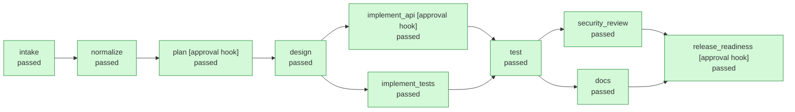

# Run `20261004-085149-20d958`: greenfield

**Status:** `succeeded`

**Requirement (v1):** Build a URL shortener service with APIs to create short links, redirect, and report click counts.

## Orchestration graph



## 1. Requirement understanding

Mode: **greenfield**. Features: create, redirect, analytics.

Assumptions:

- 'Analytics' means an aggregate click counter per link, not an event pipeline.

Acceptance criteria:

- **AC1** POST /links returns 201 and a short code for a valid http(s) URL
- **AC2** GET /{code} responds 302 to the original URL
- **AC3** Each redirect increments clicks visible at GET /links/{code}/stats; unknown codes 404
- **AC4** Unsafe URLs (non-http(s), credentials, oversized) are rejected with 422
- **AC8** Analytics store no PII

## 2. Task decomposition

| Task | Title | Stage | Depends on | Proves |
|---|---|---|---|---|
| T1 | API contract + schema | design | - | AC1, AC2, AC3 |
| T2 | URL validation policy | implement_api | T1 | AC4 |
| T3 | Persistence: links table + code allocation | implement_api | T1 | AC1 |
| T4 | POST /links | implement_api | T2, T3 | AC1, AC4 |
| T5 | GET /{code} redirect + atomic click count | implement_api | T3 | AC2, AC3 |
| T6 | GET /links/{code}/stats (no PII) | implement_api | T3 | AC3, AC8 |
| T9 | Unit + API tests mapped to acceptance criteria | implement_tests | T1 | AC1, AC2, AC3, AC4, AC8 |
| T10 | Run test suite | test | T4, T5, T6, T9 | - |
| T11 | Security / compliance / change-control review | security_review | T10 | AC8 |
| T12 | API docs + changelog | docs | T10 | - |
| T13 | Release readiness + human sign-off | release_readiness | T11, T12 | - |

Parallel waves: {T1} -> {T2, T3, T9} -> {T4, T5, T6} -> {T10} -> {T11, T12} -> {T13}

## 3. Design and codebase reasoning

Existing features: none (greenfield). Delta: analytics, create, redirect.

Risks:

- Shortener is an open redirector by design: scheme allow-list, no credentials, length cap; abuse reporting is out of scope
- Code enumeration: 7-char random codes from 62 symbols (~3.5e12 space) via secrets
- SQLite single writer: atomic UPDATE for clicks; swap to Postgres for multi-node

## 4. Execution timeline

| Batch | Stage | Status | Attempts | Rev | Start (ms) | Duration (ms) |
|---|---|---|---|---|---|---|
| 0 | intake | passed | 1 | 1 | 2 | 0 |
| 1 | normalize | passed | 1 | 1 | 4 | 0 |
| 2 | plan | passed | 1 | 1 | 5 | 0 |
| 3 | design | passed | 1 | 1 | 8 | 0 |
| 4 | implement_api | passed | 1 | 1 | 10 | 6 |
| 4 | implement_tests | passed | 1 | 1 | 11 | 11 |
| 5 | test | passed | 1 | 1 | 25 | 952 |
| 6 | security_review | passed | 1 | 1 | 980 | 9 |
| 6 | docs | passed | 1 | 1 | 981 | 1 |
| 7 | release_readiness | passed | 1 | 1 | 993 | 1 |

Batches (stages in one batch ran concurrently and joined at a barrier): 0: intake; 1: normalize; 2: plan; 3: design; 4: implement_api, implement_tests; 5: test; 6: security_review, docs; 7: release_readiness

## 5. Validation

pytest: **20 passed, 0 failed** in the generated workspace.

Policy rules checked: CHG-001, CHG-002, CMP-001, SEC-001, SEC-002, SEC-003. Violations: 0.

Release checklist:

- [x] tests_green
- [x] acceptance_criteria_traced
- [x] security_review_clean
- [x] change_within_design_scope
- [x] docs_updated
- [x] migrations_backward_compatible
- [x] full_test_suite

Traceability (acceptance criterion -> passing tests):

- AC1: test_create_redirect_and_count, test_create_and_click
- AC2: test_create_redirect_and_count
- AC3: test_create_redirect_and_count, test_unknown_code_returns_404
- AC4: test_rejects_unsafe_urls, test_rejects_bad_urls, test_rejects_oversized_url
- AC8: test_stats_expose_no_pii

Changed files: CHANGELOG.md, app/__init__.py, app/main.py, app/store.py, docs/API.md, tests/conftest.py, tests/test_api.py, tests/test_store.py. Reviewable patch: `release/change.patch`.

## 6. Governance

| Stage | Decision | By | Reason |
|---|---|---|---|
| release_readiness | approved | demo-auto | Release is a high-impact action and needs human sign-off |

## 7. Metrics

```json
{
  "success": true,
  "status": "succeeded",
  "stage_executions": 10,
  "attempts": 10,
  "failed_attempts": 0,
  "retries": 0,
  "first_pass_yield": 1.0,
  "rollbacks": 0,
  "fallbacks": 0,
  "policy_blocks": 0,
  "replans": 0,
  "approvals": 1,
  "incidents": 0,
  "mttr_ms": null,
  "e2e_latency_ms": 996,
  "active_stage_ms": 980,
  "approval_wait_ms": 0,
  "max_parallelism": 2
}
```

## 8. Decision log

| # | Stage | Event | Rev | Input hash | Detail |
|---|---|---|---|---|---|
| 1 | orchestrator | run-start |  |  | `{"scenario": "greenfield", "requirement": "Build a URL shortener service with APIs to create short links, redirect, and report click counts....` |
| 2 | orchestrator | batch-start |  |  | `{"batch": 0, "stages": ["intake"], "parallel": false}` |
| 4 | intake | stage-end | 1 | db9cce9c0fa2dda4 | `{"status": "passed", "attempts": 1, "output_hash": "05a4835a9a54f0c2"}` |
| 5 | orchestrator | batch-join |  |  | `{"batch": 0, "results": {"intake": "passed"}}` |
| 6 | orchestrator | batch-start |  |  | `{"batch": 1, "stages": ["normalize"], "parallel": false}` |
| 8 | normalize | stage-end | 1 | 95f50d8844fef27c | `{"status": "passed", "attempts": 1, "output_hash": "f3660df1d0c56138"}` |
| 9 | orchestrator | batch-join |  |  | `{"batch": 1, "results": {"normalize": "passed"}}` |
| 10 | orchestrator | batch-start |  |  | `{"batch": 2, "stages": ["plan"], "parallel": false}` |
| 12 | plan | stage-end | 1 | bc0d17be0066edc7 | `{"status": "passed", "attempts": 1, "output_hash": "4371b61341b84b50"}` |
| 13 | orchestrator | batch-join |  |  | `{"batch": 2, "results": {"plan": "passed"}}` |
| 14 | orchestrator | batch-start |  |  | `{"batch": 3, "stages": ["design"], "parallel": false}` |
| 16 | design | stage-end | 1 | 76705ac8372f5e53 | `{"status": "passed", "attempts": 1, "output_hash": "770b0c11bd8b7cf5"}` |
| 17 | orchestrator | batch-join |  |  | `{"batch": 3, "results": {"design": "passed"}}` |
| 18 | orchestrator | batch-start |  |  | `{"batch": 4, "stages": ["implement_api", "implement_tests"], "parallel": true}` |
| 21 | implement_api | stage-end | 1 | 05be7bcf842f3aed | `{"status": "passed", "attempts": 1, "output_hash": "3f3621e9d11b93d3"}` |
| 22 | implement_tests | stage-end | 1 | 05be7bcf842f3aed | `{"status": "passed", "attempts": 1, "output_hash": "81e974631734933d"}` |
| 23 | orchestrator | batch-join |  |  | `{"batch": 4, "results": {"implement_api": "passed", "implement_tests": "passed"}}` |
| 24 | orchestrator | batch-start |  |  | `{"batch": 5, "stages": ["test"], "parallel": false}` |
| 26 | test | stage-end | 1 | ae10b5ceaf332236 | `{"status": "passed", "attempts": 1, "output_hash": "9fbfa38275a49eec"}` |
| 27 | orchestrator | batch-join |  |  | `{"batch": 5, "results": {"test": "passed"}}` |
| 28 | orchestrator | batch-start |  |  | `{"batch": 6, "stages": ["security_review", "docs"], "parallel": true}` |
| 31 | docs | stage-end | 1 | e20342f81cbd6527 | `{"status": "passed", "attempts": 1, "output_hash": "355923815ad135f9"}` |
| 32 | security_review | stage-end | 1 | e20342f81cbd6527 | `{"status": "passed", "attempts": 1, "output_hash": "1465a05cfbccee7f"}` |
| 33 | orchestrator | batch-join |  |  | `{"batch": 6, "results": {"docs": "passed", "security_review": "passed"}}` |
| 34 | release_readiness | approval-requested |  |  | `{"reason": "Release is a high-impact action and needs human sign-off", "input_hash": "8e06f43e44282ce3"}` |
| 35 | release_readiness | approved |  |  | `{"by": "demo-auto", "note": "auto-approved (demo mode, recorded for audit)"}` |
| 36 | orchestrator | batch-start |  |  | `{"batch": 7, "stages": ["release_readiness"], "parallel": false}` |
| 38 | release_readiness | stage-end | 1 | 8e06f43e44282ce3 | `{"status": "passed", "attempts": 1, "output_hash": "a5481d1afb3191ba"}` |
| 39 | orchestrator | batch-join |  |  | `{"batch": 7, "results": {"release_readiness": "passed"}}` |
| 40 | orchestrator | run-complete |  |  | `{}` |
