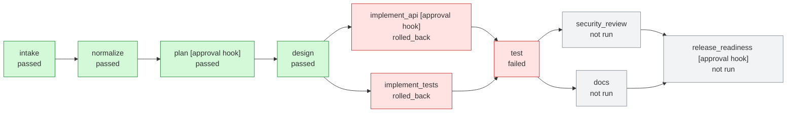

# Run `20261004-085153-0b37f2`: rollback

**Status:** `rolled_back` (test failed; workspace restored to baseline)

**Requirement (v1):** Existing shortener: add link expiry. Links accept an optional TTL, expired links must stop redirecting, and existing links must keep working.

## Orchestration graph



## 1. Requirement understanding

Mode: **brownfield**. Features: create, redirect, analytics, expiry.

Assumptions:

- Analytics not mentioned; included as an aggregate click counter (core shortener capability).

Acceptance criteria:

- **AC1** POST /links returns 201 and a short code for a valid http(s) URL
- **AC2** GET /{code} responds 302 to the original URL
- **AC3** Each redirect increments clicks visible at GET /links/{code}/stats; unknown codes 404
- **AC4** Unsafe URLs (non-http(s), credentials, oversized) are rejected with 422
- **AC5** Links past their TTL stop redirecting (410); invalid TTLs rejected
- **AC7** Existing links survive the schema change and keep redirecting
- **AC8** Analytics store no PII

## 2. Task decomposition

| Task | Title | Stage | Depends on | Proves |
|---|---|---|---|---|
| T1 | API contract + schema | design | - | AC1, AC2, AC3 |
| T2 | URL validation policy | implement_api | T1 | AC4 |
| T3 | Persistence: links table + code allocation | implement_api | T1 | AC1 |
| T4 | POST /links | implement_api | T2, T3 | AC1, AC4 |
| T5 | GET /{code} redirect + atomic click count | implement_api | T3 | AC2, AC3 |
| T6 | GET /links/{code}/stats (no PII) | implement_api | T3 | AC3, AC8 |
| T7 | Additive migration: links.expires_at | implement_api | T3 | AC7 |
| T8 | TTL validation + expiry enforcement (410) | implement_api | T3, T5, T7 | AC5, AC6 |
| T9 | Unit + API tests mapped to acceptance criteria | implement_tests | T1 | AC1, AC2, AC3, AC4, AC5, AC7, AC8 |
| T10 | Run test suite | test | T4, T5, T6, T8, T9 | - |
| T11 | Security / compliance / change-control review | security_review | T10 | AC8 |
| T12 | API docs + changelog | docs | T10 | - |
| T13 | Release readiness + human sign-off | release_readiness | T11, T12 | - |

Parallel waves: {T1} -> {T2, T3, T9} -> {T4, T5, T6, T7} -> {T8} -> {T10} -> {T11, T12} -> {T13}

## 3. Design and codebase reasoning

Existing features: analytics, create, redirect. Delta: expiry.

| Kind | Symbol | File | Change |
|---|---|---|---|
| table | `links` | app/store.py | add nullable column expires_at |
| function | `create_link` | app/store.py:62 | accept ttl, persist expires_at |
| function | `record_click` | app/store.py:84 | refuse clicks after expiry (atomic predicate) |
| route | `POST /links` | app/main.py | accept optional ttl_seconds, return expires_at |
| route | `GET /links/{code}/stats` | app/main.py | expose expires_at / expired |
| route | `GET /{code}` | app/main.py | return 410 Gone for expired links |
| tests | `tests/test_api.py` | tests/test_api.py | extend coverage; 1 existing tests exercise impacted code |
| tests | `tests/test_store.py` | tests/test_store.py | extend coverage; 3 existing tests exercise impacted code |

Data flows found in the code:

- `POST /links -> create -> create_link -> links`
- `GET /links/{code}/stats -> stats -> get_link -> links`
- `GET /{code} -> follow -> record_click -> links`

Migrations:

- `ALTER TABLE links ADD COLUMN expires_at REAL` (additive; rollback: previous build ignores the nullable column; no down-migration needed)

Risks:

- Shortener is an open redirector by design: scheme allow-list, no credentials, length cap; abuse reporting is out of scope
- Code enumeration: 7-char random codes from 62 symbols (~3.5e12 space) via secrets
- SQLite single writer: atomic UPDATE for clicks; swap to Postgres for multi-node
- Schema change on live data: additive nullable column, migration test (AC7), human approval gate

## 4. Execution timeline

| Batch | Stage | Status | Attempts | Rev | Start (ms) | Duration (ms) |
|---|---|---|---|---|---|---|
| 0 | intake | passed | 1 | 1 | 1 | 0 |
| 1 | normalize | passed | 1 | 1 | 2 | 0 |
| 2 | plan | passed | 1 | 1 | 4 | 0 |
| 3 | design | passed | 1 | 1 | 5 | 5 |
| 4 | implement_api | rolled_back | 1 | 1 | 12 | 9 |
| 4 | implement_tests | rolled_back | 1 | 1 | 13 | 4 |
| 5 | test | failed | 2 | 1 | 24 | 50 |

Batches (stages in one batch ran concurrently and joined at a barrier): 0: intake; 1: normalize; 2: plan; 3: design; 4: implement_api, implement_tests; 5: test

## 6. Governance

| Stage | Decision | By | Reason |
|---|---|---|---|
| implement_api | approved | demo-auto | Schema change on existing data: ALTER TABLE links ADD COLUMN expires_at REAL |


| Incident stage | Error | Resolution | Recovery (ms) |
|---|---|---|---|
| test | regression in redirect path (call 1) | rollback | 53 |

## 7. Metrics

```json
{
  "success": false,
  "status": "rolled_back",
  "stage_executions": 7,
  "attempts": 8,
  "failed_attempts": 2,
  "retries": 1,
  "first_pass_yield": 0.857,
  "rollbacks": 1,
  "fallbacks": 0,
  "policy_blocks": 0,
  "replans": 0,
  "approvals": 1,
  "incidents": 1,
  "mttr_ms": 53,
  "e2e_latency_ms": 77,
  "active_stage_ms": 68,
  "approval_wait_ms": 0,
  "max_parallelism": 2
}
```

## 8. Decision log

| # | Stage | Event | Rev | Input hash | Detail |
|---|---|---|---|---|---|
| 1 | orchestrator | run-start |  |  | `{"scenario": "rollback", "requirement": "Existing shortener: add link expiry. Links accept an optional TTL, expired links must stop redirect...` |
| 2 | orchestrator | batch-start |  |  | `{"batch": 0, "stages": ["intake"], "parallel": false}` |
| 4 | intake | stage-end | 1 | 8c11003b4c7453cd | `{"status": "passed", "attempts": 1, "output_hash": "cc0186c04ddbb80d"}` |
| 5 | orchestrator | batch-join |  |  | `{"batch": 0, "results": {"intake": "passed"}}` |
| 6 | orchestrator | batch-start |  |  | `{"batch": 1, "stages": ["normalize"], "parallel": false}` |
| 8 | normalize | stage-end | 1 | cfbc94ddc9dd2836 | `{"status": "passed", "attempts": 1, "output_hash": "89581b6d803227f7"}` |
| 9 | orchestrator | batch-join |  |  | `{"batch": 1, "results": {"normalize": "passed"}}` |
| 10 | orchestrator | batch-start |  |  | `{"batch": 2, "stages": ["plan"], "parallel": false}` |
| 12 | plan | stage-end | 1 | 755d26e72bbfa9f0 | `{"status": "passed", "attempts": 1, "output_hash": "87df1049ce8ad9a4"}` |
| 13 | orchestrator | batch-join |  |  | `{"batch": 2, "results": {"plan": "passed"}}` |
| 14 | orchestrator | batch-start |  |  | `{"batch": 3, "stages": ["design"], "parallel": false}` |
| 16 | design | stage-end | 1 | 31f2aa7b53325b1e | `{"status": "passed", "attempts": 1, "output_hash": "fa2b89b11786fafa"}` |
| 17 | orchestrator | batch-join |  |  | `{"batch": 3, "results": {"design": "passed"}}` |
| 18 | implement_api | approval-requested |  |  | `{"reason": "Schema change on existing data: ALTER TABLE links ADD COLUMN expires_at REAL", "input_hash": "18ee0905dc823363"}` |
| 19 | implement_api | approved |  |  | `{"by": "demo-auto", "note": "auto-approved (demo mode, recorded for audit)"}` |
| 20 | orchestrator | batch-start |  |  | `{"batch": 4, "stages": ["implement_api", "implement_tests"], "parallel": true}` |
| 23 | implement_tests | stage-end | 1 | 18ee0905dc823363 | `{"status": "passed", "attempts": 1, "output_hash": "959b0aca11d0cf1e"}` |
| 24 | implement_api | stage-end | 1 | 18ee0905dc823363 | `{"status": "passed", "attempts": 1, "output_hash": "07c2fb7a8fb55d40"}` |
| 25 | orchestrator | batch-join |  |  | `{"batch": 4, "results": {"implement_tests": "passed", "implement_api": "passed"}}` |
| 26 | orchestrator | batch-start |  |  | `{"batch": 5, "stages": ["test"], "parallel": false}` |
| 28 | test | attempt-failed | 1 | 6690a29e77ea0a21 | `{"attempt": 1, "error": "regression in redirect path (call 1)", "retryable": true}` |
| 29 | test | attempt-failed | 1 | 6690a29e77ea0a21 | `{"attempt": 2, "error": "regression in redirect path (call 2)", "retryable": true}` |
| 30 | test | stage-end | 1 | 6690a29e77ea0a21 | `{"status": "failed", "attempts": 2, "output_hash": null}` |
| 31 | orchestrator | batch-join |  |  | `{"batch": 5, "results": {"test": "failed"}}` |
| 32 | orchestrator | rollback-start |  |  | `{"failed": ["test"]}` |
| 33 | orchestrator | rollback-complete |  |  | `{"reverted_stages": ["implement_api", "implement_tests"], "workspace": "baseline"}` |
| 34 | orchestrator | safe-stop |  |  | `{"reason": "test failed; workspace restored to baseline"}` |
